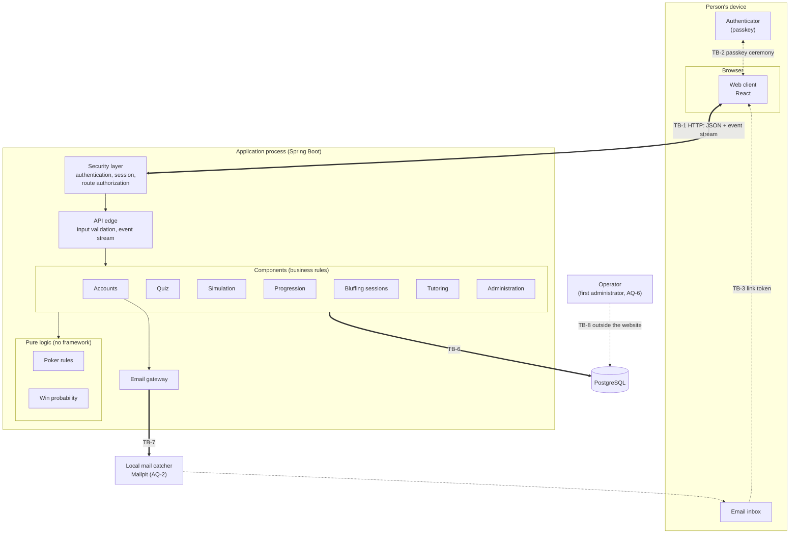
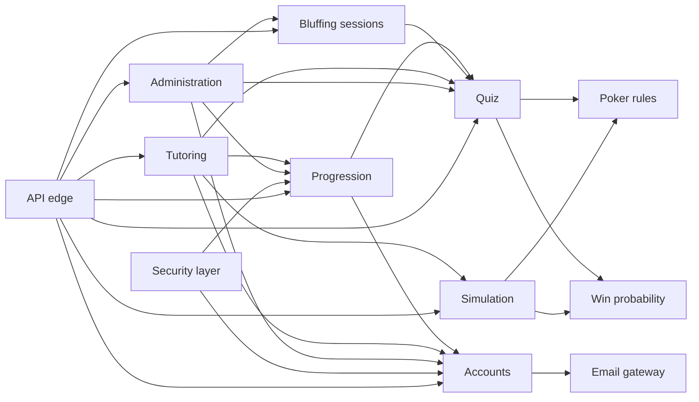
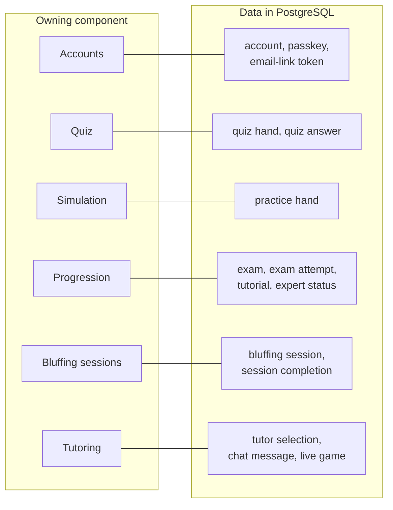
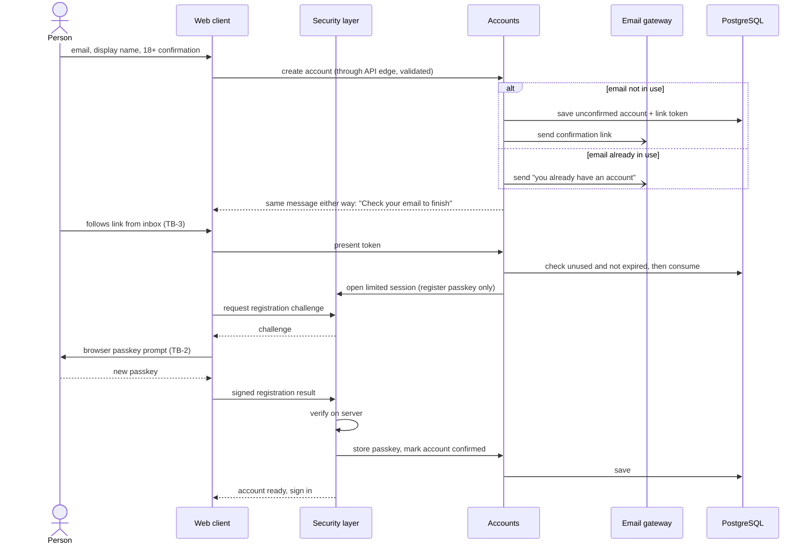
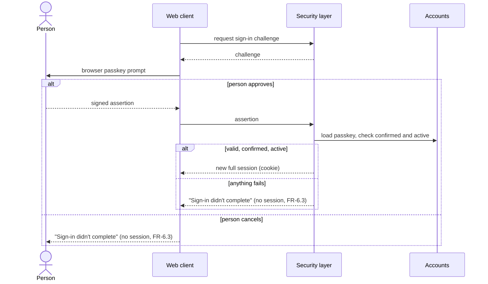
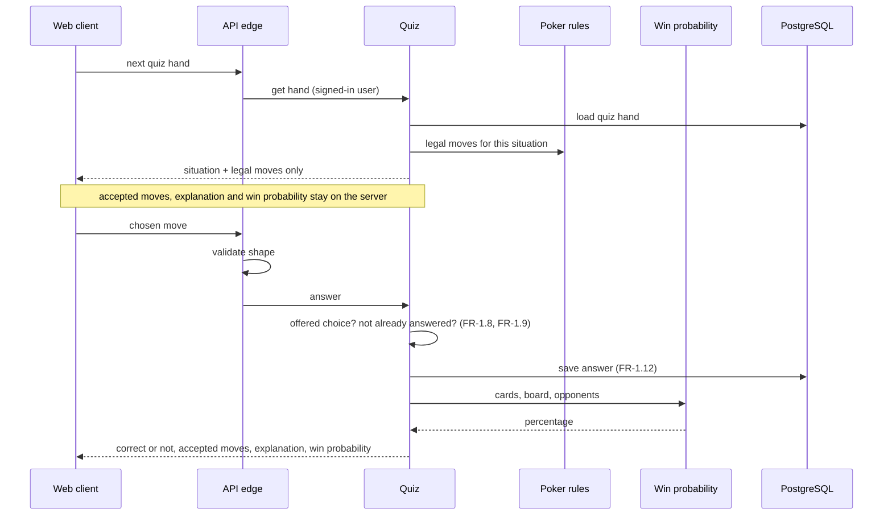
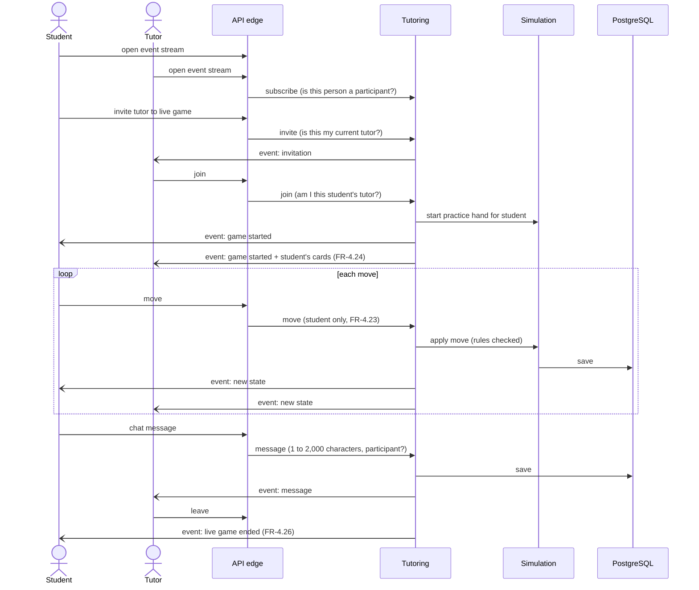
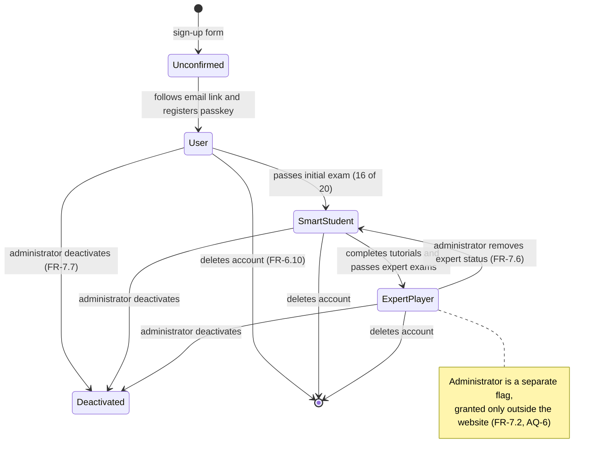

# stackademic — Architecture

This file owns HOW the system is built: components, boundaries, technology, and data flow. WHAT the system does is in `REQUIREMENTS.md`. How it looks is in `DESIGN.md`. Detailed security controls belong to `SECURITY.md`; this file only names where they are enforced.

Status words used here:

- **CONFIRMED** — an explicit owner choice or something a requirement forces.
- **PROPOSED** — chosen by the architect as the simplest fit; the owner can change it.
- **UNKNOWN** — a fact nobody has supplied yet.
- **TO BE DECIDED** — a decision that is still pending.

IDs (`DR-`, `AQ-`, `TB-`) are permanent. They are never renumbered or reused.

The owner answered the first two interview questions directly (AQ-1, AQ-2), then asked for the remaining open questions to be answered on their behalf. Every decision that comes from one of those delegated answers ends with *(assumed)*. An assumed decision is a proposed one the owner has accepted in bulk, not something the owner stated; the owner can change any of them.

Versions and support dates were checked on 2026-11-10 against the Spring project API and reference docs, Maven Central, the npm registry, postgresql.org, MDN, and endoflife.date.

## Required Architecture Inputs

- **Requirements and design sources:** `REQUIREMENTS.md` (FR-1.1 to FR-8.2, NFR-1.1 to NFR-2.4, no open questions; NFR-2.3 reworded and FR-2.10 to FR-2.13 added after the architecture interview) and `DESIGN.md` (no open questions). Most requirements are marked *(assumed)*; this file treats them as binding until the owner changes them.
- **Target surfaces:** Web UI only. No mobile app, no public API, no background jobs (REQUIREMENTS.md, assumed). The HTTP API in this file is private: it exists only to serve the web client from the same origin.
- **Runtime and deployment environment:** CONFIRMED (owner, 2026-11-10): the owner's own machine only, reached at `localhost`. No hosting, no public web address. Explicit note from the owner: this is a demo, keep the architecture modest. One application process and one database.
- **Server framework:** Java with Spring Boot (explicit choice). Version line in [Stack](#stack).
- **Client frameworks:** React (explicit choice). Version line in [Stack](#stack).
- **API style:** PROPOSED: JSON over HTTP, request/response, same origin as the web client; plus one server-to-browser event stream (Server-Sent Events) for chat and live games (AQ-7, *assumed*).
- **Authentication and session model:** Passkey sign-in (FR-6.2, WebAuthn) — CONFIRMED. PROPOSED: a server-side session identified by a cookie, created only after a successful passkey check. Email links (FR-6.6, FR-6.7) give a limited session that can do one thing: register a passkey (AQ-3, *assumed*). Sessions are kept in the application's memory (AQ-9, *assumed*).
- **Authorization model:** Roles from the requirements: user, smart student, expert player, administrator — CONFIRMED. PROPOSED: every decision is made on the server from current stored state, using three kinds of check: role, ownership ("is this my data?"), and relationship ("is this my current tutor or student?").
- **Data store and expected scale:** PostgreSQL (explicit choice), one database. Expected scale: demo use on one machine (owner, 2026-11-10); there is no scale target.
- **Logging library or platform logger:** PROPOSED: SLF4J with Logback, the Spring Boot default. No extra logging package. What to log and what never to log is owned by SECURITY.md.
- **Security expectations:** Owned by SECURITY.md (not yet written). This file names enforcement points only.

## Stack

### Platform

| Technology | Version line | Justified by | Status |
|---|---|---|---|
| Java (Eclipse Temurin JDK) | 25 LTS (25.0.x; Temurin support to 2031-09-30) | Explicit choice "Java". Spring Boot 4.1 requires Java 17+ and is compatible up to Java 27. 25 is the newest long-term-support line. | Java CONFIRMED; version 25 PROPOSED (AQ-10, *assumed*). Code targets Java 25; any JDK from 25 to 27 may build and run it, so the JDK 27 already installed works. |
| Spring Boot | 4.1.x (4.1.2 current; free support to 2027-07-31) | Explicit choice. 4.1 is the line marked current by the Spring project. 4.0.x loses free support 2026-12-31. 4.2.0 is still a release candidate (planned 2026-11-30). | Spring Boot CONFIRMED; line 4.1.x PROPOSED |
| Spring Framework | 7.0.x (7.0.10, managed by Spring Boot 4.1.2) | Required by Spring Boot 4.1. | CONFIRMED |
| Embedded Tomcat | 11.0.x (11.0.27, managed) | Spring Boot default servlet container (Servlet 6.1). | PROPOSED (default kept) |
| PostgreSQL | 18.x (18.6 current; supported to 2030-11-14) | Explicit choice "postgres". 18 is the newest released major version; 19 is only at RC 1. Run locally in Docker (AQ-13, *assumed*). | PostgreSQL CONFIRMED; version 18 PROPOSED |
| React + React DOM | 19.3.x (19.3.1) | Explicit choice "ReactJS". 19 is the only actively supported major. | React CONFIRMED; line 19.3.x PROPOSED |
| TypeScript | 7.0.x (7.0.2) | Gives the client a type-check step (see [Toolchain](#toolchain)). Not an explicit choice. | PROPOSED |
| Node.js (build time only) | 24.x LTS (24.16.0 installed; supported to 2028-04-30) | Needed to build and test the client. Satisfies every client package's engine range. Not present at run time. | PROPOSED |
| Apache Maven | 3.9+ via Maven Wrapper (3.10.0 installed; Spring Boot needs 3.6.3+) | Build tool for the server. Maven 4 is still a release candidate. | PROPOSED |
| Docker with Docker Compose (development machine only) | Docker 29.x, Compose v5.x (29.9.1 and v5.6.0 installed) | Runs the local database and the local mail catcher (AQ-2, AQ-13). Also used by Testcontainers in tests. | PROPOSED *(assumed)* |
| Mailpit (local mail catcher, run in Docker) | 1.33.x (v1.33.1 current) | AQ-2, answered by the owner: emails are caught locally and shown in a browser tab; nothing leaves the machine. Stands in for an email provider for FR-6.6 and FR-6.7. | Mail catcher CONFIRMED; Mailpit PROPOSED |

### Server packages

Every package below is version-managed by Spring Boot 4.1.2; none is pinned by hand.

| Package | Requirement it serves | Why the platform or an existing dependency cannot do it | Status |
|---|---|---|---|
| `spring-boot-starter-webmvc` | All FRs: the private HTTP API and serving the web client's files. Also provides the Server-Sent Events stream (NFR-2.4). | The JDK has no production HTTP request routing, JSON binding, or servlet container. | CONFIRMED (part of the Spring Boot choice) |
| `spring-boot-starter-security` (Spring Security 7.1.x) | FR-6.1, FR-6.3, FR-7.8, and every access rule in FR-1.14, FR-4.x. | Spring MVC alone has no authentication, session protection, or authorization layer. | PROPOSED |
| `spring-security-webauthn` (brings `webauthn4j-core` 0.31.x) | FR-6.2, FR-6.4, FR-6.7: passkey registration and sign-in. | Verifying WebAuthn attestations and assertions is specialist cryptographic protocol code; neither the JDK nor core Spring Security contains it. | PROPOSED |
| `spring-boot-starter-data-jpa` (Hibernate ORM 7.4.x) | All stored data (the entities listed in REQUIREMENTS.md). | Plain JDBC from the JDK would mean hand-written mapping for about fourteen entities. | PROPOSED (AQ-8, *assumed*) |
| `org.postgresql:postgresql` (pgJDBC 42.7.x) | Explicit choice of PostgreSQL. | The JDK ships no PostgreSQL driver. | CONFIRMED |
| `spring-boot-starter-flyway` + `flyway-database-postgresql` (Flyway 12.4.x) | All stored data: creating and changing the database structure in a repeatable, reviewed way. | Spring Boot's built-in start-up SQL scripts cannot upgrade a database that already holds data. | PROPOSED |
| `spring-boot-starter-validation` (Hibernate Validator 9.1.x) | FR-1.8, FR-4.21, FR-6.5, FR-7.4: rejecting malformed input at the API edge. | Spring MVC binds input but does not check it against declared rules without a validation provider. | PROPOSED |
| `spring-boot-starter-mail` (Angus Mail 2.0.x) | FR-6.6, FR-6.7: confirmation and recovery emails. | The JDK has no SMTP client. | PROPOSED. It sends to the local mail catcher (AQ-2). |
| `spring-boot-starter-webmvc-test`, `spring-boot-starter-security-test`, `spring-boot-starter-data-jpa-test` (JUnit 6.0.x) | Test command in [Toolchain](#toolchain). Test scope only. | The JDK has no test runner. | PROPOSED |
| `spring-boot-testcontainers` + Testcontainers PostgreSQL module (2.0.x) | Tests that touch stored data run against real PostgreSQL. Test scope only. | An in-memory substitute database does not behave like PostgreSQL. | PROPOSED |

Deliberately not added: a WebSocket/STOMP stack, a message broker, a cache, a second data store, a session-store package, a poker or hand-evaluation library, a metrics/actuator package, an API-documentation package. No requirement needs them. Random dealing (FR-2.5) uses the JDK's `SecureRandom`. Spring Boot's Docker Compose integration is also left out; the two local containers are started by hand (see [Toolchain](#toolchain)).

### Client packages

| Package | Requirement it serves | Why the platform or an existing dependency cannot do it | Status |
|---|---|---|---|
| `react`, `react-dom` 19.3.x | All screens. | Explicit choice. | CONFIRMED |
| `react-router` 8.x (8.5.1; needs React ≥ 19.2.7, Node ≥ 22.22) | Many separate screens (quiz, simulation, exams, tutors, chat, admin) with working links and browser back button. | React has no routing; hand-rolling history handling is error-prone. | PROPOSED |
| `typescript` 7.0.x | Type-check command. Build time only. | The browser platform has no static type checking. | PROPOSED |
| `vite` 8.x (8.3.7) + `@vitejs/plugin-react` 6.x | Build command: turns the client source into static files. Build time only. | Browsers cannot load JSX or TypeScript directly. | PROPOSED |
| `@types/react`, `@types/react-dom` 19.3.x | Type-check command. Build time only. | React ships without its own type declarations. | PROPOSED |
| `vitest` 5.x (5.1.0), `jsdom` 31.x, `@testing-library/react` 16.x, `@testing-library/dom` 10.x | Test command. Test time only. | Node's built-in test runner has no browser DOM and no React rendering helpers. | PROPOSED |

Deliberately not added:

- **A WebAuthn helper library.** The browser's own `navigator.credentials` API, with `PublicKeyCredential.parseCreationOptionsFromJSON` / `parseRequestOptionsFromJSON` and `toJSON` (MDN: Baseline since March 2025), covers every browser in NFR-1.1.
- **A data-fetching or state library.** The browser's `fetch` and `EventSource` and React's built-in state are enough.
- **A CSS framework or component library.** DESIGN.md defines its own tokens and components; plain CSS custom properties carry them.
- **A markdown or HTML-rendering library.** DESIGN.md forbids rendering raw markup; the limited admin format is turned into React elements by the client's own code (AQ-11, *assumed*).
- **A linter.** No requirement asks for one, and `typescript-eslint` 8.x does not yet support TypeScript 7 (peer range `<6.1.0`).

The font named in DESIGN.md (Atkinson Hyperlegible Next) is a self-hosted static file, not a package.

## Components and Flows

There is **one deployable service** (the Spring Boot application, which also serves the built web client) and **one data store** (PostgreSQL). This is CONFIRMED by the owner's choice to run the demo on one machine, and is the fewest that meet the requirements. The components below are logical parts inside that one service, except where noted.

| Component | Responsibility | Business rules enforced | Data owned | Requirement IDs | Status |
|---|---|---|---|---|---|
| **Web client** (browser) | Shows screens from DESIGN.md, collects input, runs the browser side of the passkey ceremony, listens to the event stream. | None that count. It may hide or disable things for convenience, but the server decides everything. | None. Holds only what the server sent for the current screen. | NFR-1.1 to NFR-1.3, all FR screens | SUPPORTED |
| **API edge** | Receives HTTP requests, checks input shape and size, calls one component, shapes the response and error messages. Hosts the event stream. | Input validation only (FR-1.8 shape, FR-4.21 length, FR-6.5 email form). No business rules. | None. | All FRs | SUPPORTED |
| **Security layer** | Passkey registration and sign-in, sessions, request forgery protection, the limited "register a passkey" session, the fresh passkey check, and asking the owning components whether a request is allowed. | FR-6.1, FR-6.2, FR-6.3, FR-7.7 (deactivated cannot sign in), FR-7.8. | Sessions (in server memory, AQ-9, *assumed*). Passkey credentials are stored through Accounts. | FR-6.1 to FR-6.3, FR-6.7, FR-7.7, FR-7.8 | SUPPORTED |
| **Accounts** | Account creation, email confirmation, recovery links, deactivation, deletion, the administrator flag. | FR-6.4 to FR-6.11, FR-7.2, FR-7.7. Link is single-use and expires (FR-6.8). Same response whether or not the email exists (FR-6.9). | Account, passkey, email-link tokens, administrator flag, active/deactivated flag. | FR-6.4 to FR-6.11, FR-7.1, FR-7.2, FR-7.7 | SUPPORTED |
| **Poker rules** | The rules of no-limit Hold'em cash games: dealing, which moves are legal, legal bet sizes, who wins at showdown. Pure logic, no storage, no framework. | FR-1.6, FR-2.3, FR-2.5, FR-2.6, FR-2.7, FR-2.8 (winner). | None. | FR-1.5, FR-1.6, FR-2.1 to FR-2.8 | SUPPORTED |
| **Win probability** | Works out the chance to win or tie from the user's cards, the shared cards, and the number of opponents. Pure logic. | FR-3.2, FR-3.3, NFR-2.2, NFR-2.3. | None. | FR-3.1 to FR-3.5, NFR-2.2, NFR-2.3 | SUPPORTED (method in AQ-4, *assumed*) |
| **Quiz** | Serves quiz hands, accepts one answer, marks it, shows the explanation and win probability afterwards, keeps history. | FR-1.7 to FR-1.14, FR-3.4. Accepted moves and explanation leave the server only after the answer is locked. | Quiz hand (with accepted moves and explanation), quiz answer. | FR-1.1 to FR-1.14, FR-3.4, FR-7.3, FR-7.4 | SUPPORTED |
| **Simulation** | Runs a full practice hand on the server against computer-controlled players, using play chips. | FR-2.4 to FR-2.13, FR-3.5. The server holds the deck and other players' cards; the client only gets what the user is allowed to see. | Practice hand (state and result). | FR-2.1 to FR-2.13, FR-3.5 | SUPPORTED (computer players follow FR-2.10 to FR-2.13) |
| **Progression** | Initial exam, expert tutorials and exams, pass marks, retake waiting time. Decides who is a smart student and who is an expert player. | FR-4.1 to FR-4.6, FR-4.12 to FR-4.17, FR-7.6. | Exam, exam attempt, tutorial, tutorial progress, expert status. | FR-4.1 to FR-4.6, FR-4.12 to FR-4.17, FR-7.5, FR-7.6 | SUPPORTED |
| **Bluffing sessions** | Lesson material followed by bluffing quizzes; records completion. | FR-5.2 to FR-5.4. | Bluffing session, session completion. | FR-5.1 to FR-5.4, FR-7.5 | SUPPORTED |
| **Tutoring** | Tutor list, tutor selection, one-on-one chat, live games, and pushing chat and live-game events to the two participants. | FR-4.7 to FR-4.11, FR-4.18 to FR-4.26. Only the two participants can read or receive anything. | Tutor selection, chat message, live game. | FR-4.7 to FR-4.11, FR-4.18 to FR-4.26, NFR-2.4 | SUPPORTED |
| **Administration** | Admin screens' operations: content management, removing expert status, deactivating accounts. It calls the owning components; it has no data of its own. | FR-7.3 to FR-7.8, each behind the administrator check and the fresh passkey check (DESIGN.md, assumed). | None. | FR-7.1 to FR-7.8 | SUPPORTED |
| **Email gateway** | The only part that talks to the mail server (for this demo, the local mail catcher). Sends confirmation, recovery, and "you already have an account" emails. | None. It sends what Accounts hands it. | None. | FR-6.6, FR-6.7 | SUPPORTED (sends by SMTP to the local mail catcher, AQ-2) |
| **PostgreSQL** (separate process) | Stores everything listed under "Data owned" above. | Uniqueness and referential integrity as a backstop (for example, one account per email, FR-6.5). Business rules stay in the components. | Storage only; each table has exactly one owning component (DR-4). | All FRs that store data | SUPPORTED |

### Conflicts flagged and how they were settled

These were flagged rather than silently resolved. The settlements marked *(assumed)* were made on the owner's behalf at their request.

1. **Passkey at sign-up vs. how the framework registers passkeys (AQ-3).** FR-6.4 makes passkey registration part of creating an account. Spring Security registers a passkey only for a user who is already authenticated, and a brand-new person is not. Also, DESIGN.md says a sign-up with an email already in use must look identical to a normal sign-up ("Check your email to finish"), which cannot work if the passkey prompt comes before the email step. **Settled:** form → email link → link grants a limited session → register passkey → account usable. Recovery (FR-6.7) reuses the same limited session. This reads FR-6.4 as "an account is not created until a passkey is registered", which still holds. *(assumed)*
2. **Win-probability accuracy was stated as absolute (AQ-4).** NFR-2.3 originally said the figure MUST be within 1 percentage point of the true value, with no allowance. Exact calculation is not feasible within 2 seconds (NFR-2.2) for early-hand, many-player cases, and random sampling can only promise the 1-point margin with a very high probability, not with certainty. **Settled:** exact calculation where it fits in the time limit, otherwise random sampling sized so the result is within 1 point at least 999 times in 1,000. NFR-2.3 in REQUIREMENTS.md has since been reworded to say exactly this. *(assumed)*
3. **"No background jobs" vs. sending email (FR-6.9).** If the email is sent while the person waits, the response takes visibly longer when the address has an account, which leaks what FR-6.9 hides. **Settled:** the email is handed off inside the same process and the response returns at once. This is not a scheduled job or a separate service, but it is work that finishes after the response. The control itself is owned by SECURITY.md. *(assumed)*
4. **Computer-controlled players were required but not described (AQ-5).** FR-2.4 requires them; nothing originally said how they decide. **Settled:** a small fixed rule set inside Simulation. Each computer player decides from its own cards' win probability and the price of calling, with some randomness so play is not predictable. No machine learning, no external service, no difficulty levels. REQUIREMENTS.md now states this as FR-2.10 to FR-2.13. *(assumed)*
5. **"No public API" vs. a React client.** Not a real conflict: a browser client needs an HTTP API, but it is private, same-origin, undocumented for outsiders, and accepts only the web client's session.

### Decisions on former open questions

All thirteen questions are resolved. The IDs stay reserved so later files can cite them.

| ID | Question | Decision | Decided by |
|---|---|---|---|
| AQ-1 | Where does it run, and for how many people? | The owner's machine only, at `localhost`. Demo use; no scale target. | Owner |
| AQ-2 | Which email provider? | None. A local mail catcher (Mailpit in Docker) receives every email over SMTP and shows it in a browser tab. | Owner |
| AQ-3 | Order of sign-up steps | Email link first, then passkey registration in a limited session. | *(assumed)* |
| AQ-4 | How exact must win probability be? | Exact where it fits in 2 seconds; otherwise random sampling, within 1 point at least 999 times in 1,000. | *(assumed)* |
| AQ-5 | How do computer players decide? | A small fixed rule set using win probability, the price of calling, and some randomness. | *(assumed)* |
| AQ-6 | How is the first administrator created? | The operator sets the administrator flag on an existing account directly in the database, from the machine itself. The web application has no route that can do it. | *(assumed)* |
| AQ-7 | Real-time delivery method | Server-Sent Events. No WebSocket. | *(assumed)* |
| AQ-8 | Database access style | Spring Data JPA. | *(assumed)* |
| AQ-9 | Where sessions are kept | In the application's memory. Restarting the application signs everyone out; accepted for a demo. | *(assumed)* |
| AQ-10 | Java version | Code targets Java 25 (long-term support). Any JDK from 25 to 27 may build and run it. | *(assumed)* |
| AQ-11 | Format of administrator-written content | Stored as plain text using a small fixed notation: blank line between paragraphs, `**bold**`, lines starting with `- ` for lists, and two-character card codes such as `Ad`. The client's own code turns this into React elements; anything else is shown as literal text. | *(assumed)* |
| AQ-12 | Java dependency-audit tool | OWASP Dependency-Check 13.0.0, run from the command line; not added to the build. | *(assumed)* |
| AQ-13 | Local database | PostgreSQL 18 in Docker. The installed Homebrew PostgreSQL 16 is not used. | *(assumed)* |

### Main data flows

1. **Sign-up (AQ-3, *assumed*).** Person submits email, display name, and 18+ confirmation → API edge validates → Accounts creates an unconfirmed account (or, if the email is taken, creates nothing) → Email gateway sends the matching email → same on-screen message either way. Person follows the link → Accounts checks the token (unused, not expired) → Security layer opens a limited session → browser runs the passkey registration ceremony → Security layer verifies it, Accounts stores the passkey and marks the account confirmed.
2. **Sign-in.** Browser asks for a challenge → Security layer issues one → the person's authenticator signs it → Security layer verifies the signature against the stored passkey and checks the account is confirmed and active → a new full session is created. Failure or cancel: no session (FR-6.3).
3. **Recovery.** Person submits an email → identical response always → if it matches, Accounts issues a 30-minute single-use token and the Email gateway sends it → link → limited session → register new passkey (same path as sign-up step 2).
4. **Hand quiz.** Client asks for a hand → Quiz returns the situation and the legal moves only → client submits one move → API edge validates, Quiz checks it is an offered choice and that no answer exists, marks it, saves it → response now includes correct/incorrect, accepted moves, explanation, and the figure from Win probability.
5. **Simulation.** Client starts a hand with a table size → Simulation deals using Poker rules and stores the hand → client receives only its own cards and public state → each user move is checked by Poker rules, then computer players act → after each new shared card or fold, Win probability is recalculated and returned → at the end the result and showdown cards are returned.
6. **Exams and roles.** Progression serves an exam (a set of quiz questions), enforces the retake wait, records the attempt, and records a pass. Roles are read from this stored state on every request; they are never taken from the client.
7. **Tutoring chat and live game.** Each signed-in participant holds one open event stream. Sending a chat message or making a live-game move is an ordinary validated, authorized request. After the change is saved, Tutoring pushes an event to the other participant's stream. The stream only delivers; it never accepts commands (DR-9).
8. **Administration.** Admin request → Security layer checks administrator role and a fresh passkey check → Administration calls the owning component (Quiz, Progression, Bluffing sessions, or Accounts) → that component applies its own rules (for example FR-7.4).
9. **Account deletion.** Signed-in user confirms, passes a fresh passkey check → Accounts announces the deletion → each owning component removes that user's data it owns (FR-6.10) in the same database transaction → the session ends.

### Trust boundaries and enforcement points

| ID | Boundary | What crosses it | Where authentication, authorization, and validation are enforced |
|---|---|---|---|
| **TB-1** | Browser ↔ application (HTTP on `localhost` for this demo; treated as untrusted exactly as if it were the internet) | Every request and response; the event stream. | **Authentication:** Security layer, before any component runs. **Request forgery protection:** Security layer. **Validation:** API edge (shape, size, allowed values), then the owning component (business rules). **Authorization:** Security layer for role checks on each route; owning component for ownership and relationship checks. Nothing from the client is trusted, including hidden or disabled controls. |
| **TB-2** | Authenticator ↔ browser ↔ application (passkey ceremony) | Challenges, signed responses. | Security layer verifies every signed response on the server against the stored passkey, the expected origin, and the challenge it issued. The browser's result is never taken on trust. |
| **TB-3** | Email inbox → browser → application (links) | Confirmation and recovery tokens. | Accounts validates the token (exists, unused, not expired) and consumes it. The resulting session is limited to passkey registration, enforced by the Security layer. |
| **TB-4** | User ↔ user, through the application | Chat messages, display names, live-game state, quiz results shown to a tutor. | **Authorization:** Tutoring checks the current tutor–student relationship on every read, write, and stream subscription (FR-4.19, FR-4.20). **Validation:** API edge and Tutoring (FR-4.21). **Output:** the web client renders all user text as plain text (DESIGN.md). |
| **TB-5** | Administrator → all users | Quiz hands, explanations, lessons, exams. | **Authorization:** Security layer (administrator role, fresh passkey check). **Validation:** owning component (FR-7.4) and the limited content format (AQ-11, *assumed*). **Output:** web client renders only the limited format, never raw markup. |
| **TB-6** | Application ↔ PostgreSQL | All stored data. | The application authenticates to the database with its own credentials. Only persistence code reaches the database (DR-8). End users never reach it. |
| **TB-7** | Application → mail server (the local mail catcher) | Recipient address, link token. | Outbound only; nothing received from the mail server is acted on. The local mail catcher accepts mail without credentials and must listen on `localhost` only; a real provider would require credentials here. |
| **TB-8** | Operator → system, outside the website | Granting the first administrator (FR-7.2). | The operator sets the administrator flag directly in the database, from the machine itself (AQ-6, *assumed*). **Authentication and authorization:** the database's own credentials and access to the machine. No route in the web application can grant the flag. |

## Dependency Rules

- **DR-1** The web client talks only to the application's own HTTP API on the same origin. It never talks to the database, the mail server, or any third party.
- **DR-2** Dependencies point inward and one way: API edge → components → Poker rules / Win probability. A component never depends on the API edge, and nothing in the server depends on the web client.
- **DR-3** Poker rules and Win probability depend on nothing else in the system and on no framework: no web, security, database, or email code. They take values in and return values out.
- **DR-4** Every table has exactly one owning component (the "Data owned" column). Only the owner reads or writes it. Other components ask the owner through its interface; they do not query its tables or join across owners.
- **DR-5** Component dependencies form no cycles. The allowed directions are:
  - Administration → Quiz, Progression, Bluffing sessions, Accounts
  - Tutoring → Simulation, Quiz (read a student's results), Progression (who is an expert, who has tutor access), Accounts (display names)
  - Bluffing sessions → Quiz
  - Progression → Quiz, Accounts
  - Simulation → Poker rules, Win probability
  - Quiz → Poker rules, Win probability
  - Security layer → Accounts, Progression
  - Accounts → Email gateway (through an interface Accounts defines)
- **DR-6** Accounts depends on no feature component. When an account is deleted or deactivated, Accounts announces it through an interface it owns, and each data-owning component reacts for its own data. This keeps FR-6.10 from creating a cycle.
- **DR-7** Business rules live in the components and in Poker rules / Win probability, written without transport, presentation, or vendor types. HTTP details stay in the API edge. Screen logic stays in the web client. Vendor code (passkey library, mail client, database mapping) stays behind interfaces owned by the component that needs them.
- **DR-8** Only persistence code talks to PostgreSQL, and only the Email gateway talks to the mail server.
- **DR-9** The event stream is delivery only. Every change of state goes through the same validated, authorized request path; the stream carries the result out and accepts nothing in.
- **DR-10** The server is the single authority. The client is never sent data the user may not yet see (other players' cards, accepted moves before an answer, win probability before a quiz answer), and no rule is enforced only in the client.
- **DR-11** Roles and relationships are read from stored state owned by Accounts (administrator, active) and Progression (tutor access, expert) and Tutoring (current tutor). No other component keeps its own copy.

## Diagrams

### Components and trust boundaries

### Allowed dependencies between components (DR-5, DR-6)

### Data ownership (DR-4)

### Sign-up and first passkey (AQ-3, assumed)

### Passkey sign-in

### Hand quiz: what leaves the server, and when

### Tutoring chat and live game (Server-Sent Events, AQ-7, assumed)

### How a person's access changes

## Toolchain

No source code exists in the repository yet, so none of these commands has been run here. Each was checked against the tool's official documentation and the versions installed on the owner's machine (Maven 3.10.0, Node 24.16.0, npm 11.16.0, Docker 29.9.1, Docker Compose v5.6.0). Commands are run from the server project or the client project; where those live is left to implementation.

Machine findings that affect the toolchain:

- The only JDK found is Homebrew OpenJDK 27.0.1, and it is not on the shell `PATH` (`java` fails; Maven finds it). JDK 25 is not installed. That is acceptable: the code targets Java 25 and JDK 27 can build and run it (AQ-10, *assumed*).
- The installed PostgreSQL client is 16.15. It is not used: the database is PostgreSQL 18 in Docker (AQ-13, *assumed*).

| Check | Server (Java, Maven) | Client (Node, npm) |
|---|---|---|
| Install | `./mvnw -B dependency:go-offline` | `npm ci` |
| Build | `./mvnw -B package` | `npm run build` (runs `vite build`) |
| Type-check | `./mvnw -B compile` (the Java compiler is the type checker) | `npx tsc --noEmit` |
| Test | `./mvnw -B verify` (tests that use the database need Docker running, for Testcontainers) | `npx vitest run` |
| Dependency audit | `./mvnw org.owasp:dependency-check-maven:13.0.0:check` (AQ-12, *assumed*). The first run downloads vulnerability data and is slow without an NVD API key. | `npm audit` and `npm audit signatures` |
| Lint | N/A — no linter is in the stack; the compiler's warnings are the baseline. | N/A — no linter is in the stack (`typescript-eslint` does not yet support TypeScript 7). |
| Database migration | Runs automatically at application start (Flyway). No separate command. | N/A — the client has no database. |
| Run locally | `docker compose up -d` (starts PostgreSQL 18 and Mailpit), then `./mvnw spring-boot:run` | `npm run dev` (Vite dev server, forwarding API calls to the local application) |

## Open Questions

None open. AQ-1 and AQ-2 were answered by the owner. AQ-3 to AQ-13 were answered on the owner's behalf at their request; those answers are marked *(assumed)* above and listed under [Decisions on former open questions](#decisions-on-former-open-questions).

Two of those answers changed REQUIREMENTS.md afterwards: NFR-2.3 was reworded (AQ-4), and FR-2.10 to FR-2.13 were added for computer-controlled players (AQ-5).
